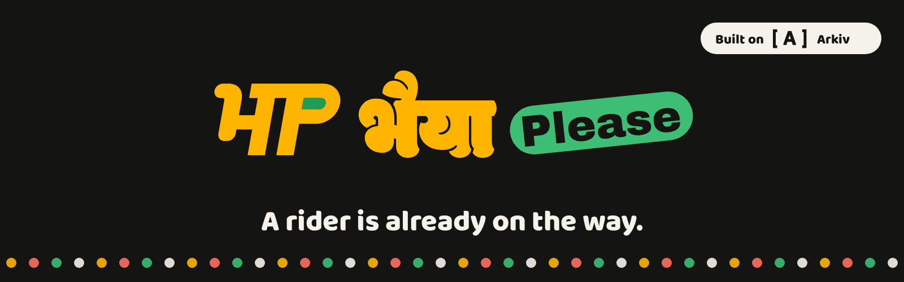
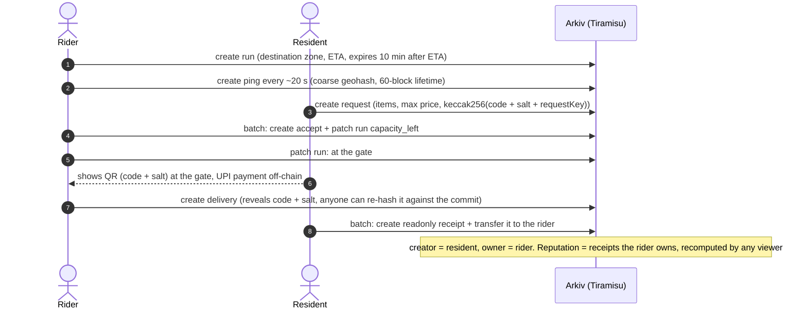
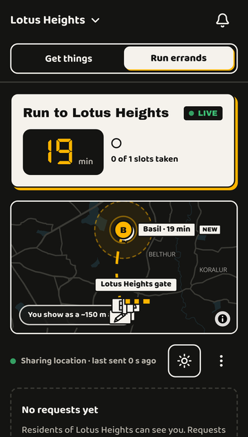
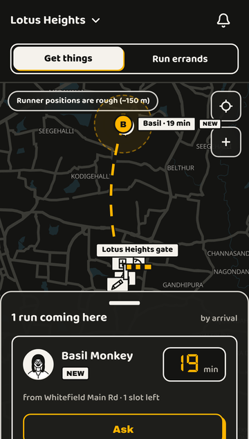
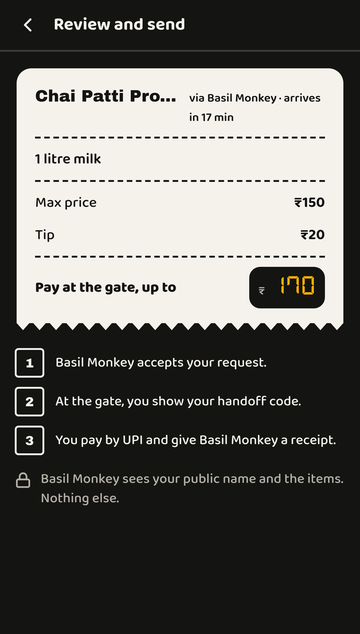
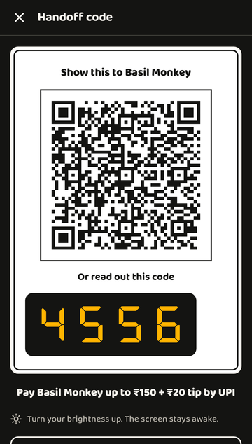
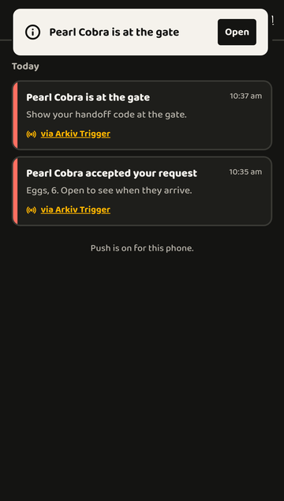
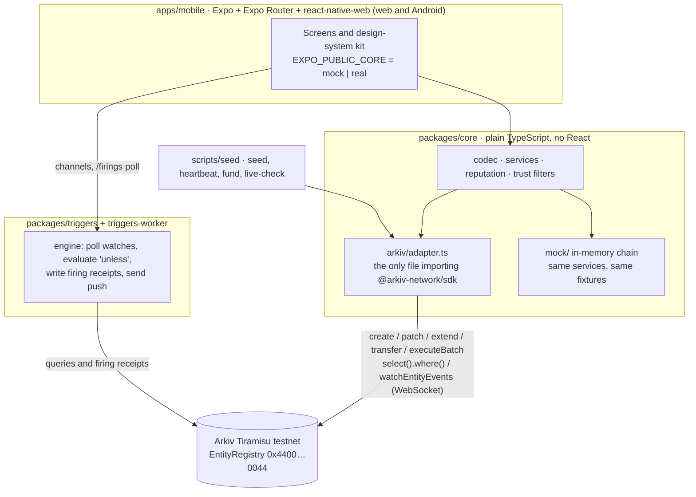

<p align="center">
  
</p>

<h3 align="center">An open errand board where the rider already heading to your gate can bring you one more thing, and every step is an <a href="https://arkiv.network">Arkiv</a> entity.</h3>

<p align="center">
  <a href="https://bhaiya-please.vercel.app"></a>
  
  
  
  <a href="LICENSE"></a>
  <br>
  <a href="https://github.com/ayush18pop/bhaiya-please/actions/workflows/ci.yml"></a>
  
  <a href="packages/triggers"></a>
</p>

<p align="center">
  <a href="https://bhaiya-please.vercel.app"><b>Live app</b></a> ·
  <a href="#demo-video">Demo video</a> ·
  <a href="arkiv/schema.md">Schema</a> ·
  <a href="arkiv/friction.md">Friction report</a> ·
  <a href="#on-chain-evidence">On-chain evidence</a>
</p>

---

Built 16-18 Oct 2026 for the Arkiv Global Tour Stop hackathon (**Best Indian Use Case** track). No pre-existing code: the first commit is the start of the work.

## The pitch

- **The problem.** Delivery riders pass our buildings all day, and many of them are already headed to our complex. Today you can only reach a rider if you are their customer. For anything else you use a ten-minute delivery app, and one litre of milk comes with delivery and handling fees.
- **The idea.** A rider who is already on the way announces a short-lived **run** to your society. A resident attaches a **request** for one to three items from a shop on the route. They meet at the gate, pay by UPI (off-chain), and the resident issues a **receipt that is transferred to the rider**. Reputation is simply the set of receipts a rider owns.
- **Why it needs Arkiv.** Runs expire on their own, receipts are authored by one person and owned by another and cannot be edited by anyone (including us), and anyone can re-verify the whole story from the chain. There is no backend of ours to trust.

> **On Firebase, reputation is a feature of our app. On Arkiv, it is an asset of the rider.**

Everything runs on **Arkiv Tiramisu testnet only**. All wallets are test wallets, all GLM is testnet GLM with no value, and all demo data is synthetic.

## Contents

1. [Why India](#why-india)
2. [Why Arkiv](#why-arkiv)
3. [How it works](#how-it-works)
4. [Features](#features)
5. [Screenshots](#screenshots)
6. [Demo video](#demo-video)
7. [On-chain evidence](#on-chain-evidence): [contracts](#contracts) · [wallets](#wallets) · [demo transactions](#demo-transactions) · [Triggers](#arkiv-triggers-on-the-live-app) · [how to verify](#how-to-verify)
8. [Architecture](#architecture) and [repository layout](#repository-layout)
9. [Quick start](#quick-start)
10. [Deployment](#deployment)
11. [Privacy and scope](#privacy-and-scope)
12. [Roadmap](#roadmap) · [Team](#team) · [Licence and credits](#licence-and-credits)

## Why India

India's delivery work runs on gig workers, and their track record belongs to the platform they work for. Bhaiya Please is built for the two people who meet at the society gate every evening.

| | |
|---|---|
| **Gig workforce** | **77 lakh** gig workers in 2020-21, projected to reach **2.35 crore by 2029-30** (NITI Aayog, *India's Booming Gig and Platform Economy*, 2022). |
| **Recognition is only starting** | Budget 2025-26: about **1 crore** platform workers to get identity cards, registration on e-Shram and health cover under PM-JAY. The Code on Social Security, 2020 lets the Centre levy **1–2% of aggregator turnover** for their welfare. |
| **Ten-minute delivery** | Quick commerce gross order value: **₹30,000 crore (FY24) → ₹64,000 crore (FY25)**, projected to pass **₹2 lakh crore by FY28** (CareEdge). Every order pays a platform's fees, including the small ones. |
| **The kirana still wins** | Kirana stores hold about **91% of India's grocery retail** (Redseer, CY2025): the shop on the rider's route is usually a kirana, not a dark store. |
| **Reputation is locked in** | A rider's ratings live inside each app, can't be taken elsewhere, and disappear when an account is deactivated. Rajasthan (2023) and Karnataka (2025) passed gig-worker laws; Karnataka's requires written reasons before deactivation and has been challenged in court by platforms. Fairwork India 2024 scored 11 platforms on five fairness principles (pay, conditions, contracts, management, representation): three got **0 out of 10**. |

**What changes for them:**
- **The rider** (delivery partner, office-goer, the neighbour's son) is already heading to the building. One more stop earns a tip on a trip they were making anyway, and every handoff becomes a **receipt they own on chain**. No platform can delete it, and it moves with them to a new phone or wallet, readable by any app built on Arkiv.
- **The resident** gets one litre of milk or a strip of medicine from the kirana on the route without a delivery fee, and pays by UPI at the gate.
- **The kirana** gets an order without paying a commission to anyone.

The app is built for how this works here: residents organised by gated society, the "bhaiya" at the gate, UPI off-chain, English, Hindi and Kannada, and Android and web from one codebase.

<sub>Sources: [NITI Aayog projection](https://indbiz.gov.in/indias-gig-economy-to-have-23-5-million-workers-by-2029-30-niti-aayog/) · [Budget 2025 measures (Ministry of Labour via All India Radio)](https://www.newsonair.gov.in/labour-employment-ministry-urges-platform-workers-to-register-themselves-on-e-shram-portal-to-access-benefits-of-ab-pmjay) · [Code on Social Security aggregator levy](https://www.mondaq.com/india/constitutional-administrative-law/1759312/social-security-for-gig-workers-in-india-do-central-and-state-laws-signal-higher-costs-for-online-platforms) · [Quick commerce GOV (CareEdge)](https://www.angelone.in/news/market-updates/quick-commerce-boom-orders-hit-64-000-crore-in-fy25-projecting-2-lakh-crore-by-fy28) · [Kirana share (Redseer)](https://redseer.com/reports/why-indias-mass-grocery-still-leans-on-kirana-stores/) · [Karnataka gig-worker law](https://www.business-humanrights.org/en/latest-news/india-karnatakas-gig-worker-law-introduces-algorithmic-transparency-but-enforcement-and-appeal-rights-remain-weak/) · [Deactivation litigation](https://www.livelaw.in/lawschool/articles/algorithmic-deactivation-article14-karnataka-gig-worker-litigation-542390) · [Fairwork India Ratings 2024](https://ruralindiaonline.org/en/library/resource/fairwork-india-ratings-2024-labour-standards-in-the-platform-economy/)</sub>

## Why Arkiv

What each Arkiv feature does for the user, and what would break on Postgres, IPFS, a subgraph or our own API. The full mapping is in [`arkiv/schema.md`](arkiv/schema.md#8-feature--what-the-user-sees).

| Arkiv feature | What would break elsewhere |
|---|---|
| `$creator` (immutable) + `$owner` + `changeOwnership` | A receipt authored by the resident and **owned by the rider** needs both facts to be unforgeable. In our own DB we would own it and could edit or lose it. IPFS has no owner or revocation. |
| `readonly` flag | A receipt, a delivery reveal and a complaint cannot be edited by anyone, including us. A database admin can. |
| Attribute expiry | Runs vanish 10 minutes after ETA, shops fade after 30 days unless someone says "still open". No cleanup job. IPFS never forgets. |
| `permissionlessExtension` | Anyone keeps a shop listing alive without owning it. Elsewhere this needs custom access control. |
| Typed attribute queries | "Runs to this building, ETA after now, capacity left" is a native range query, with no indexer or subgraph to run. |
| Atomic `executeBatch` | Accept + capacity decrement, and receipt + transfer, cannot half-happen. |
| `predictEntityKeys` | The handoff commit includes the request's own key, so it must be known before the request exists. |
| **Arkiv Triggers** (built on top) | Push alerts and provable no-shows need "do X when an entity is created or about to expire". We built it as a protocol of Arkiv entities with a worker that writes signed firing receipts back to the chain. See [`docs/TRIGGERS.md`](docs/TRIGGERS.md). |
| `watchEntityEvents` over a **WebSocket** | The app opens one WebSocket and the chain pushes every entity event, so screens react the moment the rider or resident they are looking at acts, with no refresh loop (automatic fallback to polling if the socket drops). A backend would have to do this fan-out for you. |
| No operator | The board has no backend of ours. If we vanish, receipts stay readable and owned by their holders. |

## How it works



1. **Announce.** The rider picks a destination zone and ETA. A `run` entity is created and expires by itself.
2. **Request.** The resident picks a shop and 1-3 items. The 4-digit code and a salt stay on the device; only `keccak256(code ‖ salt ‖ requestKey)` goes on chain.
3. **Accept.** One atomic batch creates the `accept` and decrements the run's capacity. Limits come from the rider's *computed* tier, not from anything the rider claims.
4. **Handoff.** At the gate the resident shows a QR. The rider scans it and writes a `delivery` containing the reveal.
5. **Receipt.** The resident issues a read-only `receipt` and transfers it to the rider in the same transaction.
6. **Reputation.** Any viewer recomputes a rider's profile from chain: valid receipts, distinct residents, complaints, and attestations from verifiers *the viewer* trusts. Nothing is stored as a score.

Off-chain on purpose: names, phone numbers, flat numbers, ID documents, exact GPS (only a coarse geohash cell), chat, payments, and the handoff secret until the rider reveals it.

## Features

| Who | What they get |
|---|---|
| **Resident** ("Get things") | Map of runs coming to your society, rider sheet, pick or add a shop, items and tip, a paper bill, live status road, handoff code (QR + meter digits), rate the handoff (receipt print and stamp), report a problem |
| **Rider** ("Run errands") | Set up a run, live location (opt-in, coarse), request inbox with accept / decline, shopping list, "I'm at the gate", scan or paste the code, run summary, a profile that shows the receipts the rider owns |
| **Society desk** (verifiers) | Invite-only screens to scan a rider, check and vouch. Vouches count only for viewers who trust that verifier address |
| **Arkiv Triggers** | In-app and push alerts ("accepted", "at the gate", "someone is heading here") driven by on-chain trigger entities, each firing recorded as a signed receipt entity. Provable no-show evidence is designed in (see limits) |
| **Everyone** | English, हिन्दी, ಕನ್ನಡ · Sunlight mode for riders · every save shows Saving / Saved / Couldn't save · a verified-record view per receipt with an explorer link |

The visual language is "Auto Meter Brutalism" (meter-digit ETAs, number-plate levels, mela-light alerts, rubber-stamped receipts, a dark brand map).

## Screenshots

The live app on Arkiv Tiramisu (Lotus Heights, a synthetic society).

<p align="center">
  
  
  
  
  
</p>
<p align="center"><sub>Rider's live run · resident's map · paper bill · handoff code (a one-off testnet code) · alerts inbox ("via Arkiv Trigger")</sub></p>

## Demo video

The 3-minute demo film shows one real errand end to end on the live app: a rider goes live, a resident asks for milk, accept, gate, handoff, receipt, then the receipt entity on the Arkiv explorer and the Arkiv Triggers alerts.

<!-- TODO: paste video link -->
Every transaction shown in the film is listed below with its explorer link.

## On-chain evidence

Everything below is on **Arkiv Tiramisu testnet** (chain id `7738577`, explorer <https://tiramisu.explorer.arkiv.network>). Addresses, hashes and block numbers can be checked against the public RPC and the SDK. Link patterns: `/tx/<hash>`, `/entity/<key>`, `/address/<addr>`.

### Contracts

Bhaiya Please deploys **no smart contracts of its own**. The only on-chain address the app talks to is Arkiv's system entity registry:

| Address | What it is | Used for | Source |
|---|---|---|---|
| [`0x4400000000000000000000000000000000000044`](https://tiramisu.explorer.arkiv.network/address/0x4400000000000000000000000000000000000044) | **Arkiv EntityRegistry** (system address). The explorer labels it `EntityRegistry`. It has no EVM bytecode (`eth_getCode` returns `0x`): the chain interprets transactions sent to it as Arkiv operations (create, update, extend, transfer, delete) | Every entity write of the app, the worker and the scripts. All 9 demo and Triggers transactions below have this address as `to` | `ARKIV_ADDRESS` in `@arkiv-network/sdk` 0.8.1 (`dist/expiry-*.js`), plus the `to` field of each transaction on chain |

The Tiramisu chain config used by the SDK: id `7738577`, native token GLM, RPC `https://rpc.tiramisu.db-chain.testnet.arkiv.network`.

### Wallets

All wallets are **testnet** wallets. Only public addresses are published; no key is in this repository. Persona keys are derived from the seed key (`keccak256(seedKey ‖ "bhaiyaplease:persona:" + id)`) and never printed or stored.

**Operator wallets**

| Address | Role | Creates / owns | Source |
|---|---|---|---|
| [`0x7975e591c26e6c6d9b0cfd9a81f6d61a921c080c`](https://tiramisu.explorer.arkiv.network/address/0x7975e591c26e6c6d9b0cfd9a81f6d61a921c080c) | **Seed / funder wallet** (`SEED_PRIVATE_KEY`) | Only sends GLM (`pnpm fund`, `pnpm seed`, heartbeat top-ups) and ran the chain spike. Creates no app entities | Derived locally from the key in `.env` and compared with this README's earlier record; 63 txs on chain |
| [`0x166efae608457303daf2af830d281922c5d6ee20`](https://tiramisu.explorer.arkiv.network/address/0x166efae608457303daf2af830d281922c5d6ee20) | **Trusted "society desk" verifier** (`VERIFIER_PRIVATE_KEY`). Trusted by the app through `EXPO_PUBLIC_TRUSTED_VERIFIERS` | `attestation` (vouch) entities for seeded riders. Any viewer may trust other verifiers instead | `.env.example`; matches the verifier key's address |
| [`0x0f6bc19ed15e4b939decb1359dcea6c30980c271`](https://tiramisu.explorer.arkiv.network/address/0x0f6bc19ed15e4b939decb1359dcea6c30980c271) | **Arkiv Triggers worker, production** (`TRIGGERS_WORKER_PRIVATE_KEY`, served at <https://arkiv-triggers-worker.onrender.com>) | `firing` receipt entities (readonly, 30 days). It pays gas for them | `GET /health` of the worker returns this address |
| [`0x2da1bea8ec53f4dc01720f64cdc29ce3a5028ba0`](https://tiramisu.explorer.arkiv.network/address/0x2da1bea8ec53f4dc01720f64cdc29ce3a5028ba0) | Local-dev worker address: what the worker derives when `TRIGGERS_WORKER_PRIVATE_KEY` is unset (persona `triggers-worker`) | Used only in the local live test in [`docs/TRIGGERS_LIVE_TEST.md`](docs/TRIGGERS_LIVE_TEST.md). Not the production worker | `docs/TRIGGERS_LIVE_TEST.md`; derivation reproduced locally |

**Seeded persona wallets** (created by `pnpm seed` on 16 Oct 2026; the first four are also the wallets the 15-minute heartbeat acts as)

| Address | Persona id | Role | Creates / owns |
|---|---|---|---|
| [`0x21f758e41831e8fed3486a8fa3d894a12f69cc1a`](https://tiramisu.explorer.arkiv.network/address/0x21f758e41831e8fed3486a8fa3d894a12f69cc1a) | `runner-trusted` | Rider, Trusted tier (30 receipts from 18 residents) | `run`, `accept`, `delivery` entities; owns the receipts transferred to it |
| [`0x7b9c76f7d847dd5dd244507ce883fa51b8f2e33a`](https://tiramisu.explorer.arkiv.network/address/0x7b9c76f7d847dd5dd244507ce883fa51b8f2e33a) | `runner-verified` | Rider, Verified tier (6 receipts, 1 complaint) | same |
| [`0x280e00fd992aa5eec367846df3501858dcf955da`](https://tiramisu.explorer.arkiv.network/address/0x280e00fd992aa5eec367846df3501858dcf955da) | `runner-new` | Rider, New tier (2 receipts) | same |
| [`0xe6cedb47644361328bdf7163889ebea122bfdc1f`](https://tiramisu.explorer.arkiv.network/address/0xe6cedb47644361328bdf7163889ebea122bfdc1f) | `resident-demo` | Demo resident and the second wallet that confirms a shop "still open" in the heartbeat | `request`, `receipt`, `shop` confirmations |

<details>
<summary>Seeded residents <code>resident-01</code> to <code>resident-18</code> (18 wallets)</summary>

| Persona id | Address |
|---|---|
| `resident-01` | [`0x24c071932da931dc9185a632da9fa9e1b27acb84`](https://tiramisu.explorer.arkiv.network/address/0x24c071932da931dc9185a632da9fa9e1b27acb84) |
| `resident-02` | [`0x61cb00b358e95208e4ab5e12eccd40bf470c40de`](https://tiramisu.explorer.arkiv.network/address/0x61cb00b358e95208e4ab5e12eccd40bf470c40de) |
| `resident-03` | [`0x2aec208b2e281c5b4b44dec5bbeb28a0ab9d1e33`](https://tiramisu.explorer.arkiv.network/address/0x2aec208b2e281c5b4b44dec5bbeb28a0ab9d1e33) |
| `resident-04` | [`0x6f4cb106b91023b29c10682a812c206aafcd04d1`](https://tiramisu.explorer.arkiv.network/address/0x6f4cb106b91023b29c10682a812c206aafcd04d1) |
| `resident-05` | [`0xf7c20fda02bfb06212a3d78e9052c8636e873596`](https://tiramisu.explorer.arkiv.network/address/0xf7c20fda02bfb06212a3d78e9052c8636e873596) |
| `resident-06` | [`0x12b18d662471b5734ee22d61891f08062380cad4`](https://tiramisu.explorer.arkiv.network/address/0x12b18d662471b5734ee22d61891f08062380cad4) |
| `resident-07` | [`0x35b7d402dd62c2b0980193aa05d93862f1a3b443`](https://tiramisu.explorer.arkiv.network/address/0x35b7d402dd62c2b0980193aa05d93862f1a3b443) |
| `resident-08` | [`0xf99e90100eecb25c4576dbba710b546467fd6070`](https://tiramisu.explorer.arkiv.network/address/0xf99e90100eecb25c4576dbba710b546467fd6070) |
| `resident-09` | [`0xd6c1cf034a1429181f750fd7805746cc39029c65`](https://tiramisu.explorer.arkiv.network/address/0xd6c1cf034a1429181f750fd7805746cc39029c65) |
| `resident-10` | [`0x3c569ddb147cae1ab152ea52bb3bbaf28bba5fce`](https://tiramisu.explorer.arkiv.network/address/0x3c569ddb147cae1ab152ea52bb3bbaf28bba5fce) |
| `resident-11` | [`0x13be7bfb570ef7b1a136d7a3c19fb0ec454d8412`](https://tiramisu.explorer.arkiv.network/address/0x13be7bfb570ef7b1a136d7a3c19fb0ec454d8412) |
| `resident-12` | [`0x51d401ea76a1744033ffa4580d50b61278f481fa`](https://tiramisu.explorer.arkiv.network/address/0x51d401ea76a1744033ffa4580d50b61278f481fa) |
| `resident-13` | [`0x89a4c82ffab9f3230aec1de1625d51c10871fd08`](https://tiramisu.explorer.arkiv.network/address/0x89a4c82ffab9f3230aec1de1625d51c10871fd08) |
| `resident-14` | [`0x44297f9cdfd7680ac16c2df9ef65edf180036430`](https://tiramisu.explorer.arkiv.network/address/0x44297f9cdfd7680ac16c2df9ef65edf180036430) |
| `resident-15` | [`0xefe33df22f9106a31fd35093573a0c483712ae8e`](https://tiramisu.explorer.arkiv.network/address/0xefe33df22f9106a31fd35093573a0c483712ae8e) |
| `resident-16` | [`0xcbc510005da0ac6a315358d78cbba459cddf64b3`](https://tiramisu.explorer.arkiv.network/address/0xcbc510005da0ac6a315358d78cbba459cddf64b3) |
| `resident-17` | [`0x6f229829008cbeb9bbfc6ff021852c4f1f4f9ca0`](https://tiramisu.explorer.arkiv.network/address/0x6f229829008cbeb9bbfc6ff021852c4f1f4f9ca0) |
| `resident-18` | [`0xac70dc43cdd8fac1b34e620a197ac58806582108`](https://tiramisu.explorer.arkiv.network/address/0xac70dc43cdd8fac1b34e620a197ac58806582108) |

Each wrote requests and receipts for the seeded riders. Judges' own burner wallets are created in the browser and create entities when they use the app.

</details>

**Demo wallets**

| Address | Role | Creates / owns |
|---|---|---|
| [`0x9d3229ef3f8d233d21b3175eaad5375883e6df56`](https://tiramisu.explorer.arkiv.network/address/0x9d3229ef3f8d233d21b3175eaad5375883e6df56) | Resident **"Marigold Koel"** | Created the `request` and the `receipt`; remains the receipt's immutable creator |
| [`0x149c4fa425c4fb35b2c9638ceafeaadfaa97e04b`](https://tiramisu.explorer.arkiv.network/address/0x149c4fa425c4fb35b2c9638ceafeaadfaa97e04b) | Rider **"Basil Monkey"** | Created the `run`, `ping`s, `accept` and `delivery`; owns the receipt after the transfer |

**Arkiv Triggers wallets**

| Address | Role | Creates / owns |
|---|---|---|
| [`0xc7d16f0c…b86df876`](https://tiramisu.explorer.arkiv.network/address/0xc7d16f0cd74ccc7cea1e1d8cbbe45a7cb86df876) | Resident **"Ruby Heron"** (push on) | Created the `request` and the `trigger` entities for alerts |
| [`0x7b33440f…ec18c87e`](https://tiramisu.explorer.arkiv.network/address/0x7b33440f1ae84362d602017283af0f49ec18c87e) | Rider **"Mint Koel"** | Created the `run` and the `accept`; marked "at the gate" |
| [`0x6ef25537…87e2c219`](https://tiramisu.explorer.arkiv.network/address/0x6ef25537dfcd621bc2142dc0a5f003bc87e2c219) | Resident **"Marigold Lynx"** (no-show run) | Created the `request` that the rider never delivered |
| [`0xfc2cec81…b5029586`](https://tiramisu.explorer.arkiv.network/address/0xfc2cec816b2adff5331b521475d5c6d8b5029586) | Rider **"Jade Elephant"** (no-show run) | Accepted the request and never reached the gate |
| [`0x0f6bc19e…0980c271`](https://tiramisu.explorer.arkiv.network/address/0x0f6bc19ed15e4b939decb1359dcea6c30980c271) | **Triggers worker** (production) | Evaluates triggers and signs every `firing` receipt and `noshow` evidence entity |

### Demo transactions

The real errand shown in the demo: resident Marigold Koel and rider Basil Monkey, society Lotus Heights, "1 litre milk" from Chai Patti Provisions, 17 Oct 2026 (about 09:17 to 09:28 UTC). Every transaction below succeeded (`status 0x1`) and was sent to the EntityRegistry. Click a hash for the transaction page, an entity key for the entity page.

| # | Step | What happened | Tx hash | Block | Sent by | Entity key |
|---|---|---|---|---|---|---|
| 1 | `announce_run` | Rider Basil Monkey goes live: creates the `run` entity for Lotus Heights (900-block lifetime) | [`0x0b99ae6c…2964c96f`](https://tiramisu.explorer.arkiv.network/tx/0x0b99ae6c67570871dd382e8863c765006b991d24e3c87f168edb2d8a2964c96f) | 689,451 | Rider | [`0xfa454944…2c9cdfad`](https://tiramisu.explorer.arkiv.network/entity/0xfa454944873a22886cb292a6c6adc94ac0e4c123167832e6aa4c8a192c9cdfad) (run) |
| 2 | `ping_example` | One of about 30 coarse location pings (`ping` entity, 60-block lifetime, sent every ~20 s while live). Only one hash was recorded | [`0xd19e333a…ce05ac7e`](https://tiramisu.explorer.arkiv.network/tx/0xd19e333a66a3bab30ad73f0ba71b4649fa9a4b97a7f2ca33c373e7bfce05ac7e) | 689,637 | Rider | [`0xd24d8a4c…62af3a44`](https://tiramisu.explorer.arkiv.network/entity/0xd24d8a4ccb75e3555f104d963da9a49843a5876056f5c7cb87cdabf662af3a44) (ping) |
| 3 | `request` | Resident Marigold Koel sends the request: 1 litre milk via Chai Patti Provisions, max 150 + 20 tip | [`0x299b6d34…539e69a5`](https://tiramisu.explorer.arkiv.network/tx/0x299b6d34a9558bfcdbe95e62b865c586a48e8dea7d377284253b8006539e69a5) | 689,554 | Resident | [`0x2b035b76…db4e14bb`](https://tiramisu.explorer.arkiv.network/entity/0x2b035b7655080281f605d2b13157c4c0d7a947915259cf4926aa39b1db4e14bb) (request) |
| 4 | `accept` | Rider accepts: one tx creates the `accept` and sets the run's `capacity_left` to 0 | [`0x2922912b…fc786f1c`](https://tiramisu.explorer.arkiv.network/tx/0x2922912b76bf1e94d37c14859aae3dbf871a35f4798fef850ea4d9e8fc786f1c) | 689,634 | Rider | [`0xcd92fdb9…c427a936`](https://tiramisu.explorer.arkiv.network/entity/0xcd92fdb997976a002cc0cb86d1c86d128b4a43c4e5d3ca17774c4be1c427a936) (accept) |
| 5 | `at_the_gate` | Rider taps "I'm at the gate": updates the `run` entity | [`0x532ecef1…1f11463b`](https://tiramisu.explorer.arkiv.network/tx/0x532ecef1117827b57c1831d367f9b8e6e24a376b76f21eff09ec57231f11463b) | 689,660 | Rider | [`0xfa454944…2c9cdfad`](https://tiramisu.explorer.arkiv.network/entity/0xfa454944873a22886cb292a6c6adc94ac0e4c123167832e6aa4c8a192c9cdfad) (run) |
| 6 | `delivery` | Rider scans the code, hash matches, `delivery` entity created with the revealed code | [`0xeeeea977…9eda36ed`](https://tiramisu.explorer.arkiv.network/tx/0xeeeea977e39a7a9ca17d4139d8ca79b38dbfa329a80a668560cf7e259eda36ed) | 689,702 | Rider | [`0x59b51ba9…fd2f4b42`](https://tiramisu.explorer.arkiv.network/entity/0x59b51ba908d4f04d6f8fb8915592ebfa3a9ac0a1faa96f58ded7f7dffd2f4b42) (delivery) |
| 7 | `receipt` | Resident gives the receipt: ONE tx = create `receipt` + extend `request` + transfer receipt to the rider | [`0x60373aef…6ca8d471`](https://tiramisu.explorer.arkiv.network/tx/0x60373aefe42ee24b6390479d2f0452c39e92e16dda8b7f48bdf0d1996ca8d471) | 689,768 | Resident | [`0x350a264f…3c42196b`](https://tiramisu.explorer.arkiv.network/entity/0x350a264f91f0ae5d5f26e750935513ddb5b41339a812ca8f32dc20483c42196b) (receipt) |

Full hashes and keys are in the link targets. Step 2 is one sample of the roughly 30 ping transactions sent during the errand.

**What the receipt transaction proves** (step 7, [`0x60373aef…6ca8d471`](https://tiramisu.explorer.arkiv.network/tx/0x60373aefe42ee24b6390479d2f0452c39e92e16dda8b7f48bdf0d1996ca8d471)): three operations in one transaction (`CREATE` receipt, `EXTEND` request, `TRANSFER` receipt to the rider). The transaction sender, and so the entity's `$creator`, is Marigold Koel; the entity's `$owner` is Basil Monkey; the entity is `readonly` and expires 15,768,000 blocks (about 365 days) after block 689,768.

### Arkiv Triggers on the live app

The Triggers worker ([`0x0f6bc19e…0980c271`](https://tiramisu.explorer.arkiv.network/address/0x0f6bc19ed15e4b939decb1359dcea6c30980c271), [arkiv-triggers-worker.onrender.com](https://arkiv-triggers-worker.onrender.com)) watches the chain for `trigger` entities, sends the push alert and writes a signed `firing` receipt entity back to Arkiv for every action.

**Push alert delivered.** Resident "Ruby Heron" turned on push in the app (a real web-push subscription). When rider "Mint Koel" accepted the request and then tapped "at the gate", the worker pushed both alerts, and the app's Alerts inbox shows each as "via Arkiv Trigger".

| Firing | Outcome | Receipt tx | Block | Firing-receipt entity | Trigger entity | Evaluated at block |
|---|---|---|---|---|---|---|
| `created`: "Mint Koel accepted your request" | `delivered` | [`0xef7f81de…3b25ff08`](https://tiramisu.explorer.arkiv.network/tx/0xef7f81de9572abfb8d306b52701f28fecb2d499a972a68a37dcb3d993b25ff08) | 733,873 | [`0x4f340185…3f30f8d5`](https://tiramisu.explorer.arkiv.network/entity/0x4f340185b1832efdf74c64acfd52eab6512288d87dcb9094b0e977ec3f30f8d5) | [`0x0d989b80…e4f0e593`](https://tiramisu.explorer.arkiv.network/entity/0x0d989b804e9d4a35b9e51cb8cc201ff3ec35cb37bd5695082e2e1a90e4f0e593) | 733,867 |
| `patched`: "Mint Koel is at the gate" | `delivered` | [`0x7f32e427…231c49d1`](https://tiramisu.explorer.arkiv.network/tx/0x7f32e42797b1e515b9257956f555f50048487e2f236904dcce78ad6c231c49d1) | 733,905 | [`0x242c9360…6bb8252e`](https://tiramisu.explorer.arkiv.network/entity/0x242c93609e421b715b8d2411a2418e6d4944474bf3688ea069da6ba66bb8252e) | [`0x3688082d…7c7104bf`](https://tiramisu.explorer.arkiv.network/entity/0x3688082d2d62c0e17aab3710e99fba5183f7a1eaeee2a8696d1fc6ea7c7104bf) | 733,900 |

The errand behind them: request [`0xcf70e064…33f7a578`](https://tiramisu.explorer.arkiv.network/entity/0xcf70e0642eed3a3caa13c09fd4aa437f0317d58c61db36c44fdf705533f7a578); accept [`0x14142abc…2ff21129`](https://tiramisu.explorer.arkiv.network/entity/0x14142abc8525b347bf02d5932deb99321c67be096f16ad8e5cda15a72ff21129); run [`0xf2479caa…e7958a77`](https://tiramisu.explorer.arkiv.network/entity/0xf2479caaa83922b9ac8cfee890d0a5659857e81e85db2bb7bb2100c0e7958a77).

**Provable no-show.** Resident "Marigold Lynx" requested an errand, rider "Jade Elephant" accepted it and never reached the gate. The deadline passed with no delivery, so the worker checked the chain at block 733,510 and, in one transaction, wrote the `noshow` evidence entity (read-only, about 180 days) and its signed firing receipt (outcome `attested`). The resident's app shows "Proof saved: anyone can check", and the report screen reads "Checked on the network".

| What | Link |
|---|---|
| Evidence + firing receipt tx (block 733,515, from the worker) | [`0x3fdd0b93…e9d988a9`](https://tiramisu.explorer.arkiv.network/tx/0x3fdd0b9387cfe8dee1f2246a79b19ef2eaa5ba727650a81e1fd105cbe9d988a9) |
| `noshow` evidence entity | [`0xe205f33e…2d9f4e5e`](https://tiramisu.explorer.arkiv.network/entity/0xe205f33e36310f5014fa7ac60b7f4bb37ed7273612816e9e56ae24102d9f4e5e) |
| Firing-receipt entity (`attested`) | [`0x9c5921ba…99af21c6`](https://tiramisu.explorer.arkiv.network/entity/0x9c5921bae760bfdc950052290154cc75021a07c27da891d5c98efb5599af21c6) |
| Trigger entity | [`0x3dfcaecc…df5d7285`](https://tiramisu.explorer.arkiv.network/entity/0x3dfcaecc462b20c73d3daeec042711f582ff1034d8391a93055fdce5df5d7285) |
| Request / run / accept | [`0x8faed9b5…ea887846`](https://tiramisu.explorer.arkiv.network/entity/0x8faed9b5e8cbdeef0b52739f0ab46a62b82adbe522af3c37e6bf42c1ea887846) · [`0x35803e66…704512e6`](https://tiramisu.explorer.arkiv.network/entity/0x35803e66cb5f955d6361d49190e8ce5f80b1b59fe023e2b1aba27df3704512e6) · [`0xfb2e53fa…c2f415c9`](https://tiramisu.explorer.arkiv.network/entity/0xfb2e53fa586714fc677394f3ea5959c1fa273dd5787858b362aebc52c2f415c9) |

### How to verify

1. **Open a transaction link** (for example the step 7 receipt). You should see **Status: Success**, **From** = the wallet in the "Sent by" column, **To** = `EntityRegistry` ([`0x4400…0044`](https://tiramisu.explorer.arkiv.network/address/0x4400000000000000000000000000000000000044)), the block number from the table, and the decoded Arkiv operations (`CREATE`, `EXTEND`, `TRANSFER` for the receipt) with the entity key and its attributes.
2. **Open the receipt entity link.** You should see the entity as `Active`, **Owner (last transfer)** = Basil Monkey's wallet, the creating transaction, its `readonly` flag and the expiry (about 365 days). The creator is the wallet that sent the creating transaction: Marigold Koel's.
3. **Open a firing-receipt entity.** You should see `Active`, created by the worker's address, expiring about 30 days after creation, with attributes `trigger`, `entity`, `event`, `outcome`, `block` and `at` (spec: [`docs/TRIGGERS.md`](docs/TRIGGERS.md#1-entities-project-tag-arkivtriggers)).
4. **Cross-check in the app.** In the live app open a receipt, then **Verified record** → **Advanced**: Record ID, Creator, Owner and an explorer link, all read from Arkiv.
5. **Or ask the chain directly** with any Arkiv-aware tool or the SDK (`publicClient.getEntity(key)`), or the JSON-RPC `eth_getTransactionReceipt` on `https://rpc.tiramisu.db-chain.testnet.arkiv.network`.

> **Entities expire; transactions do not.** Arkiv entities have a lifetime (a `run` lives until 10 minutes after its ETA, a `ping` about 2 minutes, a receipt about a year). The creation transactions stay on chain, so the transaction links above are the lasting record.

## Architecture



The app only talks to the `BhaiyaPlease` interface. `EXPO_PUBLIC_CORE=mock` runs the same services over an in-memory chain for offline development. Deeper write-ups: [`docs/TRIGGERS.md`](docs/TRIGGERS.md), [`docs/SDK_NOTES.md`](docs/SDK_NOTES.md), [`arkiv/schema.md`](arkiv/schema.md) (entities, attributes, expiry, queries, trust model).

### Repository layout

```
apps/mobile/            Expo + Expo Router + react-native-web app (web build: pnpm build:web)
  app/                  routes: welcome, society, (app)/(tabs), request, runner, desk, settings
  screens/              screen implementations per area (onboarding, resident, runner, shared, desk)
  components/bp/        UI kit implementing the design system
  components/map/       MapLibre map (web + native) with brand markers
packages/core/          domain layer over Arkiv: codec, services, reputation, adapter, mock, tests
packages/triggers/      Arkiv Triggers protocol: codec, client helpers, engine, plugins, tests
packages/triggers-worker/  Node worker: HTTP channel API, Web Push / Expo push / webhooks, Dockerfile, render.yaml
scripts/seed/           seed.ts, heartbeat.ts, fund.ts, live-check.ts
scripts/spike/          chain spike: PASS/FAIL for each risky SDK behaviour
arkiv/                  schema.md and friction.md (hackathon deliverables)
docs/                   TESTING, DEPLOY, TRIGGERS, TRIGGERS_LIVE_TEST, SDK_NOTES
.github/workflows/      ci.yml (tests + typecheck), heartbeat.yml
```

## Quick start

Requirements: Node >= 20, pnpm 10.

```bash
pnpm install
cp .env.example .env        # needed for seed / spike / heartbeat / fund; the mock app needs none
pnpm test                   # core unit + e2e tests (in-memory chain, no network)
pnpm typecheck              # all workspaces
pnpm dev                    # the app in MOCK mode (EXPO_PUBLIC_CORE=mock): fully offline
```

Full walkthroughs (offline mode, real chain with two accounts, Android) are in [`docs/TESTING.md`](docs/TESTING.md). Expo reads `EXPO_PUBLIC_*` from `apps/mobile/.env`, not the root `.env`.

### Against the real chain

You need a funded **test** key (faucet: <https://hub.arkiv.network/faucet>; an optional access key from <https://hub.arkiv.network> raises rate limits).

```bash
# .env: SEED_PRIVATE_KEY=0x... (test key only), optionally ARKIV_ACCESS_KEY=...
pnpm spike                  # exercises every risky Arkiv primitive, prints PASS/FAIL (arkiv/friction.md section B)
pnpm seed                   # funds persona wallets, replays the fixture plan through the REAL core, prints addresses
pnpm seed -- --dry          # print derived persona addresses only (no chain access)
pnpm seed -- --resume       # continue an interrupted seed without duplicating what is on chain
pnpm fund 0xADDR [0xADDR..] # top up any account from the seed wallet
pnpm heartbeat              # announce a few synthetic runs so the board is never empty
pnpm live-check             # 23-step full-loop check on Tiramisu (LIVECHECK_ANON=1: no access key)
EXPO_PUBLIC_CORE=real pnpm dev          # the app against Tiramisu
EXPO_PUBLIC_CORE=real EXPO_PUBLIC_TRUSTED_VERIFIERS=0x166efae608457303daf2af830d281922c5d6ee20 \
  EXPO_PUBLIC_ARKIV_ACCESS_KEY=<web key> pnpm build:web   # static web export against Tiramisu
```

Every write costs gas (one create is about 0.000125 GLM); 0.01 GLM covers a full rider + resident + verifier flow many times over. In the app, your address is under Profile → Settings → Advanced. To try as a judge: open a rider's profile (the seeded Trusted rider has 30 receipts from 18 distinct residents), open a receipt and read its **Verified record**. The literal queries are in [`arkiv/schema.md`](arkiv/schema.md#5-queries-the-app-runs).

> **The access key in a static web build is public.** Anything in `EXPO_PUBLIC_*` ships in the JavaScript bundle. Use a *separate* hub.arkiv.network key for the web build, restrict its Origins, and treat it as a rate-limit key, never a secret. Core sends it as the `X-API-KEY` header (never in the URL). The app also works without a key (anonymous limit observed: 600 requests per minute).

### Arkiv Triggers worker, locally

```bash
pnpm triggers:vapid         # once: generates Web Push VAPID keys (the private key is a secret)
pnpm triggers:worker        # prints the worker address and serves the channel API on :8787
pnpm fund 0x<worker address>   # the worker pays gas for firing receipts
```

Point the app at it with `EXPO_PUBLIC_TRIGGERS_URL` and `EXPO_PUBLIC_TRIGGERS_WORKER`. Protocol, HTTP API and limits: [`packages/triggers/README.md`](packages/triggers/README.md).

## Deployment

| Piece | Where | Settings |
|---|---|---|
| Real app | Vercel project, root `apps/mobile`, <https://bhaiya-please.vercel.app> | install `cd ../.. && pnpm install --frozen-lockfile`, build `npx expo export --platform web`, output `dist`, `EXPO_PUBLIC_CORE=real` |
| Triggers worker | Render web service from `packages/triggers-worker/render.yaml` (Docker), <https://arkiv-triggers-worker.onrender.com> | health check `/health`, persistent disk at `TRIGGERS_DATA_DIR` in the checked-in blueprint |
| Heartbeat | GitHub Action `.github/workflows/heartbeat.yml`, every 15 minutes | keeps a few runs on the board |

Worker environment (names only; set the secrets in the host dashboard, never in the repository):

| Variable | Purpose | Secret |
|---|---|---|
| `ARKIV_RPC_URL` | `https://rpc.tiramisu.db-chain.testnet.arkiv.network` | no |
| `ARKIV_ACCESS_KEY` | hub.arkiv.network key for the worker | **yes** |
| `TRIGGERS_WORKER_PRIVATE_KEY` | test wallet that signs firing receipts | **yes** |
| `TRIGGERS_VAPID_PUBLIC` / `TRIGGERS_VAPID_PRIVATE` / `TRIGGERS_VAPID_SUBJECT` | Web Push (public key, private key, `mailto:`) | private key: **yes** |
| `TRIGGERS_PORT` | `10000` on Render (its default `PORT`) | no |
| `TRIGGERS_POLL_MS` / `TRIGGERS_REFRESH_MS` | poll tick and trigger refresh, ms | no |
| `TRIGGERS_DATA_DIR` | channels and engine state (JSON, mode 0600) | no |
| `TRIGGERS_ALLOWED_ORIGINS` | CORS origins, e.g. the Vercel URL | no |

Web build variables: `EXPO_PUBLIC_CORE`, `EXPO_PUBLIC_ARKIV_RPC_URL`, `EXPO_PUBLIC_TRUSTED_VERIFIERS`, `EXPO_PUBLIC_ARKIV_ACCESS_KEY` (public once bundled), `EXPO_PUBLIC_TRIGGERS_URL`, `EXPO_PUBLIC_TRIGGERS_WORKER`. Deep routes need the `index.html` rewrite. The complete deploy and smoke-test guide is [`docs/DEPLOY.md`](docs/DEPLOY.md).

The heartbeat acts as the seeded demo wallets (rider personas and `resident-demo`) with testnet-only GitHub secrets, announcing 2-3 synthetic runs per tick.

## Privacy and scope

- **Testnet only.** Arkiv Tiramisu. Test wallets, GLM with no value, synthetic data.
- **Off-chain by design:** payments (UPI), names, phone numbers and exact GPS. Location pings are coarse (a 153 m cell), opt-in and short-lived.
- The trust model, its limits and the friction we met are written up in [`arkiv/schema.md`](arkiv/schema.md) and [`arkiv/friction.md`](arkiv/friction.md).

## Roadmap

- An always-on, multi-worker Triggers network with real-device push.
- Serve reads through a small relay so no access key ships in the web bundle.
- Native Android release with background location for riders.
- More verifiers: resident welfare associations vouching for riders on their own terms.
- Triggers as a reusable, app-neutral service for other Arkiv apps.

## Team

Built by two people:

- X [@ayuxhtwt](https://x.com/ayuxhtwt)
- X [@divyanshh_kalra](https://x.com/divyanshh_kalra)

## Licence and credits

Code: **MIT**, see [`LICENSE`](LICENSE).

- Data layer: [Arkiv](https://arkiv.network) on the Tiramisu testnet, via `@arkiv-network/sdk`. The Arkiv mark is theirs.
- Design system: "Auto Meter Brutalism" (our own).
- Fonts (SIL Open Font Licence): Archivo Black, Baloo 2, DSEG7, Noto Sans Mono.
- Maps: [OpenFreeMap](https://openfreemap.org) tiles with data from [OpenStreetMap](https://www.openstreetmap.org/copyright) contributors, rendered with MapLibre.
