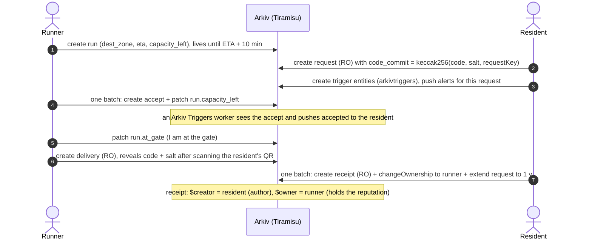
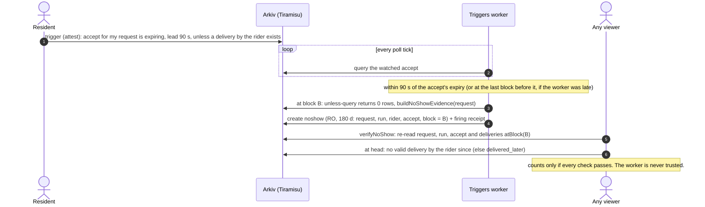

# Arkiv schema

**Bhaiya Please** stores its whole marketplace as plain Arkiv entities: **no smart contracts, no off-chain index, no backend database.** This file lists every entity, attribute, flag, lifetime and query the app uses, the trust rule applied to each read, and what each Arkiv feature changes for the user.

| | |
|---|---|
| **Chain** | Arkiv Tiramisu testnet, chain id `7738577` |
| **SDK** | `@arkiv-network/sdk` 0.8.1 (with `viem` 2.57.7) |
| **Project tags** | `bhaiyaplease` (the app's 11 entity types) · `arkivtriggers` (the `trigger` / `firing` entities of [Arkiv Triggers](../docs/TRIGGERS.md)) |
| **Source of truth in code** | attribute table [`codec/attrs.ts`](../packages/core/src/codec/attrs.ts) · encoders [`codec/entities.ts`](../packages/core/src/codec/entities.ts) · validators [`codec/schemas.ts`](../packages/core/src/codec/schemas.ts) · lifetimes [`services/context.ts`](../packages/core/src/services/context.ts) · the only SDK importer [`arkiv/adapter.ts`](../packages/core/src/arkiv/adapter.ts) · Triggers codec [`packages/triggers/src/codec.ts`](../packages/triggers/src/codec.ts) |
| **Verified on chain** | Every write-side behaviour below ran against Tiramisu with funded keys: `pnpm spike` 29/29 PASS, the full fixture history written through the production core with `pnpm seed`, the real-chain web build driven end to end (16 Oct 2026), and a live Arkiv Triggers run with signed receipts ([`docs/TRIGGERS_LIVE_TEST.md`](../docs/TRIGGERS_LIVE_TEST.md), 17 Oct 2026). Section 10 lists each assumption with its chain result. |

## Contents

- [At a glance: one handoff on chain](#at-a-glance-one-handoff-on-chain)
1. [Conventions](#1-conventions)
2. [Entity types](#2-entity-types)
3. [Attributes](#3-attributes-besides-project-type)
4. [Payloads](#4-payloads-json)
5. [Queries the app runs](#5-queries-the-app-runs)
6. [Trust model](#6-trust-model)
7. [Keeping screens fresh](#7-keeping-screens-fresh)
8. [Feature → what the user sees](#8-feature--what-the-user-sees)
9. [Deliberately off Arkiv](#9-deliberately-off-arkiv)
10. [Write-side assumptions: chain results](#10-write-side-assumptions-chain-results-16-oct-2026-sdk-081-tiramisu)
11. [`ping`: live location that deletes itself](#11-ping-live-location-that-deletes-itself)
12. [`noshow`: no-show evidence via Arkiv Triggers](#12-noshow-no-show-evidence-via-arkiv-triggers)
13. [Arkiv Triggers entities: `trigger` and `firing`](#13-arkiv-triggers-entities-trigger-and-firing)

## At a glance: one handoff on chain

Each arrow is one transaction signed by that person's own wallet. **RO** = readonly.



If the runner accepts and never delivers, an Arkiv Triggers worker writes a `noshow` that anyone can re-verify at a past block (section 12).

## 1. Conventions

- Every entity carries `project = str('bhaiyaplease')` and `type = str('<entity>')`. Anyone can write that tag, so **nothing is trusted because of it**: trust comes from `$creator` / `$owner` (section 6).
- The payload is UTF-8 JSON, `contentType = application/json`, always far below the 128 KiB limit.
- Addresses, keys and bytes32 values are lowercased in core, so comparisons are plain `===`.
- Lifetimes are given to the SDK as `ExpirationTime.fromSeconds(n)`, with `n` rounded up to a whole number of 2 s blocks (minimum 2). The chain returns `$expiresAt` as a block number; the adapter converts it to unix seconds with `getBlockTiming()`.
- Every read is validated with zod. Entities with a wrong tag, wrong attribute type, bad geohash, out-of-range number or malformed payload are **dropped** (reported to `onSdkError`), never shown.
- Reputation is **never stored**. There is no score, rank or tier entity.

## 2. Entity types

Attribute types are Arkiv attribute types (`str`, `i32`, `u64`, `addr`, `key`, `bytes32`). Flags: **RO** = `readonly`, **PE** = `permissionlessExtension`. Flags are immutable after creation.

| Entity | Flags | Expiry (from creation) | Created by | `$owner` | Why this ownership |
|---|---|---|---|---|---|
| `shop` | PE | 30 d; any wallet's "still open" resets it to now + 30 d | any wallet (lister) | lister | Community data where nobody needs special rights. PE lets neighbours keep it alive instead of the lister. |
| `run` | none (must be patched) | `etaMinutes*60 + 600` s (ETA + 10 min) | runner | runner | Only the runner may decrement `capacity_left`, set `at_gate` or delete the run. Not RO because accept and `markAtGate` patch it. |
| `request` | RO | `max(60, run.expiresAt - now + 3600)` s (run expiry + 1 h grace). Extended to 1 y when a receipt is issued, and to 180 d when a complaint is filed (each only if that moves expiry later) | resident | resident | The commit must be immutable (RO), and the resident keeps the right to extend or delete it (`cancelRequest` deletes it while no valid accept exists). |
| `accept` | none | `max(2, run.expiresAt - now)` s (dies with the run) | runner | runner | Proves the runner took the job. Written atomically with the run patch. |
| `decline` | RO | `max(2, run.expiresAt - now)` s (dies with the run) | runner | runner | The runner's "no" to one request. RO so it cannot be re-pointed. A declined request can no longer be accepted. |
| `delivery` | RO | 1 y | runner | runner | The runner reveals the handoff secret. RO so the reveal cannot be rewritten. |
| `receipt` | RO | 1 y; the owner (runner) can renew it for +1 y | **resident** | **runner** (transferred) | The point of the project. The resident authors it (`$creator`: unforgeable, immutable) but the **runner owns it**, so reputation is a portable asset the runner holds and renews, and no platform database owns it. |
| `complaint` | RO | 180 d | resident | resident | The accused runner cannot delete or edit it (they are not the owner). The resident keeps ownership on purpose. |
| `attestation` | RO | 180 d | verifier | verifier | Contains no ID data, only "this wallet was checked". The verifier revokes by deleting (RO still allows delete). |
| `ping` | RO | `min(120 s, run.$expiresAt - now)` | runner | runner | A coarse live position that the chain deletes after 2 minutes (section 11). |
| `noshow` | RO | 180 d | **anyone** (normally an Arkiv Triggers worker running the `bhaiyaplease.noshow` attester) | writer | Evidence that "at block B the runner had accepted, the ETA had passed and nothing was delivered". The writer is **not** trusted: every viewer re-reads the chain at B (`atBlock`) before counting it (sections 6 and 12). RO so the claimed block and keys cannot be re-pointed. |

The two Arkiv Triggers entities (`trigger`, `firing`, project `arkivtriggers`) are in section 13.

## 3. Attributes (besides `project`, `type`)

| Attribute | Arkiv type | Used by | Purpose |
|---|---|---|---|
| `subject` | addr | attestation | Wallet being attested |
| `level` | str | attestation | `id_checked` / `resident` / `successor` |
| `prev` | addr | attestation (only `successor`; required iff successor) | Old wallet whose receipts carry over (key rotation) |
| `at` | u64 | attestation, receipt, complaint, noshow, ping | Writer-declared unix time (noshow: the time of `block`). Reputation windows use `$createdAt`, not this. `at` exists because `$createdAt` is not filterable, and the complaint query filters `at >= since` |
| `zone` | str (geohash-6) | shop, delivery, receipt | Shop location / delivery zone |
| `zone5` | str (geohash-5) | shop, ping | Route or catchment area. Must equal `zone[0..5]` (ping: `gh7[0..5]`) or the entity is dropped |
| `category` | str | shop | `grocery` `bakery` `pharmacy_otc` `stationery` `household` |
| `name_tag` | str (1-48 chars) | shop | Public shop name (synthetic in the demo) |
| `dest_zone` | str (geohash-6) | run, request | Destination building zone |
| `from_zone` | str (geohash-6) | run | Where the runner is coming from |
| `eta` | u64 | run | Unix seconds. u64 so it supports range queries |
| `capacity_left` | i32 (0-3) | run | Decremented by `accept` in the same batch |
| `tier` | i32 (0-2) | run | **Self-declared** tier at announce time. A display hint only; limits always use the viewer-computed tier |
| `at_gate` | u64 (optional) | run | Unix seconds when the runner last signalled "at the gate" (`markAtGate`, a partial patch). Absent until first set; runs without it still decode |
| `run` | key | request, accept, decline, noshow, ping | The run this entity refers to |
| `shop` | key | request | Shop to buy from |
| `max_price` | i32 (rupees, 0-100000) | request | Price ceiling, checked against the runner's computed tier cap |
| `tip` | i32 (rupees) | request | Tip offered |
| `code_commit` | bytes32 | request | `keccak256(utf8(code) ‖ salt(16 B) ‖ requestKey(32 B))` |
| `request` | key | accept, decline, delivery, complaint, noshow | The request referred to |
| `rider` | addr | accept, decline, delivery, receipt, complaint, noshow, ping | The runner |
| `resident` | addr | delivery | The request's creator (informational; trust uses `$creator`) |
| `delivery` | key | receipt | The delivery being credited |
| `reason` | str | complaint | `no_show` / `wrong_item` / `rude` |
| `accept` | key | noshow | The runner's Accept that the claim relies on (live at `block`) |
| `block` | u64 | noshow | Block number the claim was evaluated at. Verifiers re-read the chain at exactly this block |
| `gh7` | str (geohash-7) | ping | Coarsened position (section 11) |
| `seq` | i32 (optional) | ping | Per-run sequence number |

Per entity (exactly `ENTITY_ATTRS` in code; `[x]` = optional):

```
attestation: subject level [prev] at
shop:        zone zone5 category name_tag
run:         dest_zone from_zone eta capacity_left tier [at_gate]
request:     run shop dest_zone max_price tip code_commit
accept:      request run rider
decline:     request run rider
delivery:    request rider resident zone
receipt:     rider delivery zone at
complaint:   rider request reason at
noshow:      request run rider accept block at
ping:        run rider gh7 zone5 at [seq]
```

## 4. Payloads (JSON)

| Entity | Payload | Notes |
|---|---|---|
| shop | `{}` | |
| run | `{ "note"?: string<=140 }` | Free text, synthetic in the demo |
| request | `{ "items": string[1..3] }` | Each item 1-80 chars, e.g. "1 L toned milk" |
| accept | `{}` | |
| decline | `{}` | |
| delivery | `{ "code": "0427", "salt": "0x<32 hex>" }` | The **reveal**. Public by design: it only proves the handoff happened, and this is the first time the code touches Arkiv |
| receipt | `{ "tags": ReceiptTag[0..5] }` | `exact_item` `on_time` `polite` `good_price` `careful_packing`, no duplicates |
| complaint | `{}` | |
| attestation | `{}` | |
| ping | `{ "heading"?: 0..360, "speedKmh"?: 0..200 }` | Both optional |
| noshow | `{}` | |

Payloads with no schema accept any JSON object and ignore its contents.

## 5. Queries the app runs

Queries are built with the typed builder `publicClient.select('*').where([...]).limit(200)` (`.ownedBy` → `$owner`, `.createdBy` → `$creator`, `.atBlock` for history). Multi-page walks are pinned to the block of the first page (`.atBlock(page.blockNumber)`), restart once on an expired cursor, and stop at 2000 rows with a reported (not silent) truncation.

The strings below are the SDK's own rendering of those builders (`String(builder)`), with illustrative values. `…` stands for `project = str('bhaiyaplease') AND`, which one helper always prepends together with `type = str('<type>')`.

| Used by (core API) | Query |
|---|---|
| `getLiveRuns(destZone)` | `project = str('bhaiyaplease') AND type = str('run') AND dest_zone = str('tdr3c1') AND eta > u64(1760000000) AND capacity_left > i32(0)` |
| `getMyRuns()` | `… type = str('run') AND $creator = addr(0x…)` |
| `getShops(zone5, category?)` | `… type = str('shop') AND zone5 = str('tdr3c') [AND category = str('grocery')]` |
| `getRequestsForRun(runKey)` | `… type = str('request') AND run = key(0x…)` |
| `getMyRequests()` | `… type = str('request') AND $creator = addr(0x…)` |
| accepts for a run (capacity, trust) | `… type = str('accept') AND run = key(0x…) AND $creator = addr(<runner>)` |
| `getAcceptForRequest(requestKey)`, the accepted check in `cancelRequest` / `declineRequest` | `… type = str('accept') AND request = key(0x…) AND $creator = addr(<run creator>)` |
| `getDeclineForRequest(requestKey)`, the declined check in `acceptRequest` / `declineRequest` | `… type = str('decline') AND request = key(0x…) AND $creator = addr(<run creator>)` |
| `getDeliveryForRequest(requestKey)` | `… type = str('delivery') AND request = key(0x…)` |
| `getReceiptsFor(rider)` (reputation core) | `… type = str('receipt') AND $owner = addr(<rider>)`, then per receipt a read of its Delivery and that Delivery's Request |
| `issueReceipt` duplicate check | `… type = str('receipt') AND delivery = key(0x…) AND $creator = addr(<resident>)` |
| `transferAllReceipts()` | `… type = str('receipt') AND $owner = addr(<self>)` |
| `getComplaintsAgainst(rider, since?)` | `… type = str('complaint') AND rider = addr(0x…) [AND at >= u64(since)]`, then a read of each referenced Request and of its evidence: for `no_show`, `… type = str('noshow') AND request = key(0x…) AND rider = addr(<rider>)`, verified as below; otherwise `… type = str('delivery') AND request = key(0x…) AND $creator = addr(<rider>)` (the rider served it) |
| `getNoShowsFor(rider)`, profile `noShows` | `… type = str('noshow') AND rider = addr(0x…)`, then each one verified (next row) |
| `getNoShowForRequest(requestKey)`, the evidence check in `fileComplaint` (`no_show`) | `… type = str('noshow') AND request = key(0x…) [AND rider = addr(<rider>)]`, then each one verified |
| `verifyNoShow(noshow)`, `buildNoShowEvidence` | at `noshow.block` (`.atBlock(B)`): `$key` reads of the Request, Run and Accept, and `… type = str('delivery') AND request = key(0x…)`; then at head `… type = str('delivery') AND request = key(0x…) AND $creator = addr(<rider>)` (late handoff) |
| `fileComplaint` duplicate check | `… type = str('complaint') AND request = key(0x…) AND $creator = addr(<resident>)` |
| `getAttestationsFor(subject)` | `… type = str('attestation') AND subject = addr(0x…)` |
| `getMyIssuedAttestations()` | `… type = str('attestation') AND $creator = addr(<verifier>)` |
| `getLatestPings(zone5)` / `getLatestPings(runKeys)` / `getRunTrail(runKey)` | section 11 |
| any single-entity read (`getRun`, `getShop`, `getRequest`, `inspect`, joins) | `$key = key(0x…)` (implemented as a query on `$key`, not `getEntity`) |
| `getProfileAt(addr, block)` | the profile queries above, each with `.atBlock(block)` |
| Arkiv Triggers (alerts list, firing receipts, worker watches) | section 13 |

Also used (not queries): `predictEntityKeys({owner, count})`, `getBlockTiming()`, `getBlockNumber()`, `getBalance()`, and the writes `createEntity` `patchEntity` `extendEntity` `changeOwnership` `deleteEntity` `executeBatch`.

Never used: `!=` / `ne()` (the node rejects it, section 10 #11), `getEntityCount()`, match-all queries.

## 6. Trust model

Anyone can create any entity with `project=bhaiyaplease`. Only `$creator` (immutable) and `$owner` are unforgeable, so every read applies these rules (code: `packages/core/src/services/*.ts`):

| Read | Accepted only if | Stops |
|---|---|---|
| Run | `run.$owner == run.$creator`. Limits use the runner's **computed** tier, never the `tier` attribute | Run hijack after a transfer; fake "Trusted" claims |
| Accept | `accept.$creator == run.$creator`, `accept.rider == accept.$creator`, and it refers to this run. The earliest per request wins | Strangers "accepting" for a runner; double accepts |
| Decline | The same rule as Accept: `decline.$creator == decline.rider == run.$creator`, and it refers to this request and run. The earliest wins | Strangers blocking a request by "declining" it for the runner |
| Delivery | The reveal hashes to `request.code_commit`; `delivery.$creator == delivery.rider`; the rider is not the requester; if a live Accept exists, the rider matches it. The earliest wins | Fake deliveries (only the resident and the scanning runner know the salted secret); a requester delivering to themselves; another runner stealing credit |
| Receipt | The delivery exists; the reveal verifies; `delivery.rider == receipt.rider`; **`request.$creator == receipt.$creator`**; `receipt.$creator != receipt.rider`; the receipt, delivery and request were all created **readonly** (otherwise `not_readonly`); the receipt is owned by the profile's wallet (`$owner` query) | Receipts for deliveries the issuer was not party to; self-issued receipts; a mutable receipt the runner (its owner) could re-point; a mutable request whose commit could be swapped |
| Duplicates | Only the **earliest** valid receipt per request counts. Later ones are marked `duplicate` and shown greyed | A resident minting many receipts for one handoff |
| Self-dealing | `receipt.$creator == rider` is invalid (`self_dealing`) | A runner issuing receipts to themselves |
| Complaint | `complaint.$creator == request.$creator`, `complaint.$creator != rider`, **and evidence**: for reason `no_show`, a verified `noshow` for that request naming `complaint.rider` (next row); for any other reason, proof the rider served that request, i.e. a readonly Delivery for it with `$creator == rider == complaint.rider` whose reveal hashes to the commit. One per request. `fileComplaint` applies the same check before spending gas (`INVALID_INPUT` otherwise) | Drive-by complaints: without evidence, any wallet that posted *any* request could pin complaints on *any* runner and push a Trusted runner down with three cheap writes |
| NoShow | Any `$creator`. Valid only if, **re-read at `noshow.block`**: the request exists and `request.run == noshow.run`; the run is trusted (`$owner == $creator`); `noshow.accept` is the runner's own valid Accept for that request and run (Accept rule above) with `accept.rider == noshow.rider == run.$creator`; the block's time is `>= run.eta`; and no trusted Delivery (Delivery rule above) exists. Then, at head, the rider must not have recorded a valid Delivery for the request since (`delivered_later`: a late handoff cancels the no-show). One per request (the earliest valid one wins; later copies are `duplicate`) | A worker (or anyone) inventing no-shows: the claim is only a pointer to a block, and the chain's state at that block decides |
| Attestation | Counted as "verified" only if `$creator` is in the **viewer's** trusted-verifier list (`EXPO_PUBLIC_TRUSTED_VERIFIERS`), the attestation is **readonly**, `attestation.$creator != subject`, and it has not expired | Anyone minting "ID-checked"; a mutable attestation whose subject could be patched |
| Ping | `ping.$creator == ping.rider == run.$creator`, and the run is live and trusted (section 11) | Strangers moving someone else's marker |
| Shop | Passes zod; `zone5 == zone[0..5]` | Malformed junk |

**Reputation** is computed in [`services/reputation.ts`](../packages/core/src/services/reputation.ts), with no writes, from:
- valid receipts and the count of distinct `$creator`s;
- a last-30-day window by `$createdAt`;
- complaints, counted separately;
- verified no-shows (`noShows`, and `noShows30d` by `$createdAt`). These are shown, and count toward tiers only through the `no_show` complaints they back.

| Tier | Requirement | Price cap | Requests per run |
|---|---|---|---|
| New | — | ₹200 | 1 |
| Verified | a trusted live attestation | ₹500 | 2 |
| Trusted | Verified, ≥ 25 valid receipts from ≥ 15 distinct residents, and ≤ 2 complaints in 30 d | ₹1000 | 3 |

A trusted `successor` attestation carries the `prev` wallet's receipts over.

### Known limits (stated, not hidden)

- **Receipt farming:** a determined attacker with N wallets can farm receipts from N fake "residents" by running requests against themselves. Mitigation: the Trusted tier requires a verifier attestation, which cannot be farmed, and New-tier caps are small.
- **No-show evidence has edges:**
  - Verification depends on the node serving historical state for that block. If it cannot, the noshow is reported `history_unavailable` and does not count.
  - A late handoff before the run expires cancels it (`delivered_later`).
  - The resident must file the `no_show` complaint while the Request is still live (run expiry + 1 h; filing extends it to 180 d).
  - If no worker is running, there is no evidence. Anyone may write it, though, including the resident.
- **Reputation is transferable:** receipts can be transferred by their owner (that is what makes key rotation work), so a runner could hand its receipts to another wallet. The profile counts whatever receipts a wallet owns. Reputation is portable by design, and therefore also sellable.
- **Renewed receipts eventually stop verifying:** `extendReceipt` renews a receipt, but the Request it is verified against is owned by the resident and expires after 1 y. After that, the renewed receipt no longer verifies. The UI does not claim renewal.
- **Demo verifier:** in demo mode the app also trusts the verifier wallet created in the same browser, so a judge can try the verifier flow. Other viewers do not trust it.
- **Honesty of receipts:** receipts are only as honest as the resident who issues them. The system proves *who said it*, not that it is true.
- **Handoff secret:** a 4-digit code plus a 16-byte random salt. The salt prevents brute-forcing the 10,000 possible codes from `code_commit`.
- **Key loss:** the runner can `changeOwnership` every receipt to a new wallet (`transferAllReceipts`), or a verifier issues a `successor` attestation.

## 7. Keeping screens fresh

**Expiry produces no event.** Runs, pings and shops are hidden by `eta` / `$expiresAt` against a ticking clock, and queries stop returning expired entities on the next refetch.

| Situation | How screens stay fresh | Why |
|---|---|---|
| **Real chain** | **Live push over one WebSocket.** The app opens a single `watchEntityEvents` subscription on a WebSocket transport (no `fromBlock`, no refresh loop). The event already names the entity's owner, so we read nothing for it: when the owner is the viewer or someone on their screen (the rider on their request, the resident on their run), the affected screens refetch within about a second (debounced, at most once every 15 s). If the socket cannot connect or drops, core falls back to the SDK's HTTP poller automatically. Polling per query family (`FRESHNESS` in [`hooks/queries.ts`](../apps/mobile/hooks/queries.ts)) stays as the backstop and pauses in background tabs. The moments that matter (accepted, at the gate, handed over, declined, new request, run ending) also arrive as push notifications from **Arkiv Triggers** (section 13). | The WebSocket is free of RPC quota; classifying a foreign entity would cost one read each on the shared testnet (friction 22), so we filter on the owner in the event instead of reading. |
| **Offline mock chain** | The app subscribes to core events and refreshes only the query families the event's entity type affects (debounced 400 ms). The Triggers engine runs in the page and fires in-app notifications. | Mock events are free. |

Polling intervals on the real chain:

| Query family | Interval |
|---|---|
| live board, pings, runner board, request status | 20 s |
| my requests, run detail, run rows, no-show evidence | 30 s |
| my runs | 60 s |
| profiles, receipts, attestations | 2 min |
| shops | 5 min |

Core also exports a shared `watchEntityEvents` watcher (`subscribe()`, [`arkiv/watcher.ts`](../packages/core/src/arkiv/watcher.ts): unknown keys resolved at ≤ 10 reads/s, foreign keys remembered) for tools and the offline mock, and `watchOwners()`, the read-free owner-filtered hint the app uses on the real chain.

## 8. Feature → what the user sees

"UI" reflects `apps/mobile` on `main` (Expo Router screens under `app/(app)/` and `screens/`).

| Arkiv feature | Entity / call | What the user sees | In the UI |
|---|---|---|---|
| Expiry | `run` (ETA + 10 min) | Runs on the board count down and vanish by themselves. A runner never has to clean up | yes (resident home, runner home) |
| Expiry (short) | `ping` (2 min) | The runner's marker on the live map fades when sharing stops, and the chain deletes the position | yes (live map) |
| Typed range query | `eta > u64`, `capacity_left > i32` | "Runs to your building" list, ordered by ETA, with full runs hidden | yes |
| Attribute query | `zone5`, `category` | Shops on the runner's route | yes |
| `permissionlessExtension` + `extendEntity` | `shop` | Anyone taps "still open". The shop shows when it was last confirmed and when it fades, derived from `$expiresAt` | yes (`shop/[key]`, list a shop in `shop/new`) |
| `predictEntityKeys` + `bytes32` + `key` attrs | `request.code_commit` | The resident gets a QR and a 4-digit code. The runner's scan is verified against the on-chain commit | yes (`request/[key]/code`, `runner/scan`) |
| Atomic `executeBatch` (create + patch) | `accept` + `run.capacity_left` | Capacity drops exactly when a request is accepted, never out of sync | yes (`runner/request/[key]`) |
| Partial `patchEntity` | `run.at_gate` (`markAtGate`) | The runner taps "I'm at the gate", and the resident gets a push. Only `at_gate` changes, while `capacity_left` and expiry stay | yes (`runner/gate`) |
| `createEntity(readonly)` + expiry tied to the run | `decline` | The runner turns a request down, and it can no longer be accepted | yes (`runner/request/[key]`) |
| `deleteEntity` on a readonly entity (owner) | `request` (`cancelRequest`) | The resident withdraws a request nobody has accepted yet. Refused once a valid accept exists | yes (`request/[key]`) |
| `readonly` | request, delivery, receipt, complaint, attestation | The receipt screen shows "locked", and nobody can edit a receipt | yes (`receipt/[key]`) |
| `changeOwnership` in the issuing batch | `receipt` | The receipt appears on the runner's profile, and the resident remains its author | yes (`request/[key]/rate`) |
| `$creator` vs `$owner` | receipt | The receipt screen shows "written by" the resident and "owned by" the runner. The profile counts "N handoffs from M residents" | yes |
| Client-side reputation from queries | profile | Tier badge, handoff counts and tags, with no stored score | yes (`p/[addr]`) |
| Complaints owned by the resident | `complaint` | The complaint shows on the runner's profile, and the runner cannot remove it | yes (`request/[key]/report`) |
| `atBlock` re-verification of a third-party claim | `noshow` | "Runner didn't show up" is offered only when a verified no-show exists. Profiles list no-shows | yes (`request/[key]/report`, `p/[addr]`) |
| Entities as subscriptions (Arkiv Triggers) | `trigger` (owned by the user, expires with its subject) | Push alerts for a request or a run. Settings lists active alerts, and the user can stop any of them (deletes the entity) | yes (`settings/notifications`) |
| Signed firing receipts (Arkiv Triggers) | `firing` | Notifications say "via Arkiv Trigger" and link to the receipt the worker wrote | yes (`notifications`) |
| Attestation + trusted list | `attestation` | "ID-checked by <verifier>" and a tier lift, only for verifiers the viewer trusts. The verifier can revoke | yes (`desk/*`) |
| `deleteEntity` | run, attestation | The runner cancels a run; the verifier revokes | yes |
| Bulk `changeOwnership` | `transferAllReceipts` | Move all receipts to a new wallet | yes (`backup`) |
| `successor` attestation | attestation | Shown as "Moved from an older account" when present | shown; issuing is core only |
| `extendEntity` by the owner | receipt | The runner renews receipts for another year | core only |
| `atBlock` historical profile | `getProfileAt` | "Tier when you accepted" dispute view | core only |
| `watchEntityEvents` over a WebSocket transport | all | Screens refresh within about a second when the rider or resident they are looking at acts (section 7) | yes (app-wide) |

"Core only" features are implemented and tested in `packages/core`, but are not claimed as user-visible.

## 9. Deliberately off Arkiv

| Never written to Arkiv | Where it lives instead |
|---|---|
| Names, phone numbers, flat / door numbers, ID documents or numbers | Not collected by the app. An attestation records only "this wallet was checked" |
| Exact GPS | On the device. Only a geohash-6 cell (requests, runs) or a geohash-7 cell (pings, opt-in) leaves it |
| Chat, payments | UPI at the gate, off-chain |
| The handoff code and salt | Device storage, **until the runner reveals them in the Delivery** |
| Private keys, access keys | Device / server environment |
| Push endpoints | The Triggers worker. Only an opaque channel id is on chain (section 13) |
| Reputation scores | Nowhere: always recomputed from receipts |
| Zone labels, the trusted-verifier list | App configuration (per viewer) |
| Any delivery-platform data | Not used |

All demo content is synthetic: fictional shop names, persona ids and generic item lines.

## 10. Write-side assumptions: chain results (16 Oct 2026, SDK 0.8.1, Tiramisu)

All of these were open questions before the spike, and all are now verified on chain. Reproduce with `pnpm spike` (details and exact error texts in [`friction.md`](friction.md) section B).

| # | Assumption | Result | What the code does |
|---|---|---|---|
| 1 | `changeOwnership` of an entity created earlier in the **same** `executeBatch` is accepted | **PASS**: readonly create + extend + transfer in one batch; owner = recipient, creator = issuer, readonly = true | The receipt batch is the default path. The `two_tx` fallback stays as defence in depth and never triggered during seeding |
| 2 | `extendEntity` works on a **readonly** entity | **PASS** (owner extend, and the new owner after a transfer) | Receipt and complaint batches extend the readonly Request |
| 3 | A non-owner can extend a `permissionlessExtension` entity, and a plain entity rejects it | **PASS** both ways (rejection text: `entity … is owned by 0x…, not 0x…`) | "Still open" works from any wallet; confirmed from a fresh browser burner |
| 4 | A partial `set` in `patchEntity` leaves expiry and other attributes untouched | **PASS** (`$expiresAt` unchanged) | The accept batch patches only `capacity_left`; `markAtGate` only `at_gate` |
| 5 | The `predictEntityKeys` key equals the created key when `salt` is passed | **PASS** (single creates and batches; never mismatched over the whole seed) | Mismatch handling kept |
| 6 | Access key accepted; browsers can reach the RPC | **PASS**: the URL path suffix and the `X-API-KEY` header both work; a wrong key gives HTTP 401 `INVALID_KEY`; CORS preflight allows `Content-Type, Authorization, X-Api-Key` from `*`. Anonymous rate limit: 600 requests / 60 s. Reads are additionally metered by a cost-based quota (about 100 units per `arkiv_query`, [`friction.md`](friction.md) finding 21) | Core sends the key as the `X-API-KEY` header (not in the URL, so it cannot leak through error messages). A spent quota (`QUOTA_EXHAUSTED`) is never retried; a keyed client falls back to anonymous reads, then pauses reads for 60 s. In a static web build the key is public, so restrict its Origins on hub.arkiv.network |
| 7 | Block-to-time via `getBlockTiming()` | **PASS**: `currentBlockTime` in unix seconds, `blockDuration` 2 | Unchanged |
| 8 | Read-after-write latency | The entity is visible to `select` ~230 ms after the receipt | The seed still waits 2.5 s per write (safety margin) |
| 9 | Explorer URL path | Not verified | The link is only shown when `EXPO_PUBLIC_EXPLORER_URL` is set |
| 10 | Injected (MetaMask) signer | Not exercised | Optional path; burner keys are the default |
| 11 | `!=` / `ne()` | Rejected by the node: `QueryError` kind `type`, code -32002 | Never used |

## 11. `ping`: live location that deletes itself

Added for the map-first tracking screens. Code: codec [`codec/ping.ts`](../packages/core/src/codec/ping.ts), service [`services/locations.ts`](../packages/core/src/services/locations.ts), geometry [`geo.ts`](../packages/core/src/geo.ts), rules `PING_RULES` in `types.ts`.

| Entity | Flags | Expiry | Created by / `$owner` | Why |
|---|---|---|---|---|
| `ping` | RO | `min(120 s, run.$expiresAt - now)`: a ping never outlives its run | runner / runner | A coarse "I am around here" for one live run. Nobody edits it (RO), and nobody deletes it: the chain does, 2 minutes later. |

| Attribute | Type | Purpose |
|---|---|---|
| `run` | key | The run this position belongs to |
| `rider` | addr | Must equal `$creator` (and the run's `$creator`) |
| `gh7` | str (geohash-7, ~153 m × 153 m) | The position. **Coarsened on the device** (`coarsenToGh7`); exact lat/lng is never written |
| `zone5` | str (geohash-5) | `gh7[0..5]`; a mismatch drops the ping. Lets a viewer query "pings around my area" |
| `at` | u64 | Writer-declared unix time (an ordering hint only; freshness uses `$createdAt`) |
| `seq` | i32 (optional) | Per-run sequence number |

The payload is `{ "heading"?: 0..360, "speedKmh"?: 0..200 }`, with both fields optional.

**Writes and cadence:**
- The runner app publishes one ping every 20 s (`PING_RULES.intervalSeconds`), **only while its run is live and the runner has sharing switched on**.
- It stops when the run ends or expires. `publishPing` throws `EXPIRED` then, and `NOT_OWNER` for anyone but the run's creator.
- Position comes from `expo-location` (foreground permission; browser Geolocation on web), or in demo mode from a synthetic route ("Simulate route").

| Used by | Query |
|---|---|
| `getLatestPings(zone5)` | `… type = str('ping') AND zone5 = str('tdr3c')` |
| `getLatestPings(runKeys)` | `… type = str('ping') AND (run = key(0x…) OR run = key(0x…))` |
| `getRunTrail(runKey)` | `… type = str('ping') AND run = key(0x…) AND $creator = addr(<runner>)` |

**Trust:**
- A ping counts only if `ping.$creator == ping.rider == run.$creator`, and the run is a live, trusted run (`$owner == $creator`).
- Forged pings are ignored: anyone else naming the run, or the runner naming someone else as rider.
- The latest valid ping per run wins (ordered by `$createdAt`, then `seq`, then `at`).
- Viewers fade a marker whose latest ping is older than 60 s (`staleAfterSeconds`), and drop it at expiry, because an expired ping no longer exists.

**What the user sees:**
- **Residents** see each runner heading to their gate as a pulsing, tier-coloured marker with "N min away · Ns ago" and a short breadcrumb trail (the ≤ 6 pings still alive).
- **Runners** see "Sharing live location · deletes itself in 2 min", with an off switch.

**Demo data:** the mock chain and `scripts/seed/heartbeat.ts` (≤ 6 pings per announced run per invocation) move runners along a deterministic synthetic route in the demo zones (Whitefield, Bengaluru). No real person's location is ever written.

**Privacy limits (stated):** a 153 m cell still reveals roughly where a runner is while sharing. That is the point of the feature: it is opt-in per run and disappears after 2 minutes. Pings are public, like every Arkiv entity.

## 12. `noshow`: no-show evidence via Arkiv Triggers

An Accept dies with its run, so "the runner accepted and never came" used to be unprovable once the run expired. A `noshow` turns that moment into evidence that **anyone can re-check**, because it points at a block and Arkiv can be read as it was at that block.



Contract: [`docs/TRIGGERS.md`](../docs/TRIGGERS.md) §4. Code: codec `encode.noshow` / `decode.noshow` ([`codec/entities.ts`](../packages/core/src/codec/entities.ts)), rules [`services/noshow.ts`](../packages/core/src/services/noshow.ts).

- **Writer:** the `bhaiyaplease.noshow` attester calls `buildNoShowEvidence(port, project, requestKey)`, exported from `@bhaiya-please/core`, `/mock` and `/port`. It reads through `port.at(port.blockNumber())`, so the facts it writes are exactly what a verifier will re-read. It returns `{ spec, block }` (a readonly, 180 d `CreateSpec`) or `null`, and the worker writes `spec` with its own wallet. If the worker was down during the 90 s window, the engine evaluates a late `expiring` at the last block before expiry, so the evidence still verifies.
- **Verifier:** `verifyNoShow(noshow)` on the client (or the pure `verifyNoShowEvidence(port, project, noshow)`). It returns `{ valid: true }` or `{ valid: false, reason }`, with `reason` one of `request_missing`, `run_missing`, `accept_missing`, `rider_mismatch`, `before_eta`, `delivered`, `delivered_later`, `duplicate`, `history_unavailable`.
- **Reads:**
  - `getNoShowsFor(rider)`: all of them, each with `valid`.
  - `getNoShowForRequest(requestKey)`: the valid one, else the newest invalid one, else null.
  - `Profile.noShows` / `noShows30d`: valid ones only.
- **Companion access:**
  - `BhaiyaPlease.arkivPort()` returns the underlying `ArkivPort`. Writes go through `port.write()`, which shares the wallet's queue.
  - `@bhaiya-please/core/port` exports `createArkivAdapter`, the port types and the attribute helpers (`strV u64V i32V addrV keyV bytes32V attr`).
  - `@bhaiya-please/core/mock` exports `createMockPort({ address, shareWith?, store? })`, and every mock client has `dev.port(address)` (another wallet on the same in-memory chain).
- **Mock history:**
  - The mock chain keeps superseded entity versions (block = `floor(unix / 2)`).
  - `port.at(block)` returns the state after that block's last transaction, with expiry evaluated at the block's time. This works for the last 200 days, holding at most 3000 superseded versions, pings excluded.
  - `getProfileAt` therefore works on the mock too.
  - A future block throws `INVALID_INPUT`.

## 13. Arkiv Triggers entities: `trigger` and `firing`

[Arkiv Triggers](../docs/TRIGGERS.md) is a reusable, project-agnostic automation layer: "when an entity matching this query is created / patched / about to expire / expired / deleted, unless this other query has rows, do this action". A subscription is itself an Arkiv entity, and every action is receipted on chain. Bhaiya Please is its first client. Code: [`packages/triggers`](../packages/triggers) (codec, client helpers, engine) and [`packages/triggers-worker`](../packages/triggers-worker) (Node worker). Live run: [`docs/TRIGGERS_LIVE_TEST.md`](../docs/TRIGGERS_LIVE_TEST.md).

| Entity | Project | Flags | Expiry | Created by / `$owner` | Why |
|---|---|---|---|---|---|
| `trigger` | `arkivtriggers` | none | Chosen by the subscriber. The app ties it to the watched subject (below), so subscriptions clean themselves up through expiry, with no unsubscribe job | subscriber (the user's own wallet) / subscriber | The subscription belongs to the user: only they can delete it (turning the alert off). A worker acts on a push trigger only if `trigger.$creator` registered the delivery channel. |
| `firing` | `arkivtriggers` | RO | 30 d | worker / worker | The worker's signed claim "I evaluated this at block B and did X". Anyone can audit what a worker did and when. |

**`trigger` attributes:**

| Attribute | Type | Meaning |
|---|---|---|
| `watch_project` | str | The project tag of the watched entities (`bhaiyaplease`) |
| `watch_type` | str | The watched entity type |
| `on` | str | `created` · `patched` · `expiring` · `expired` · `deleted` |
| `action` | str | `push` · `webhook` · `attest` |
| `channel` | bytes32 | An opaque id of a delivery channel registered off-chain with a worker (never the endpoint itself). Zero for `attest` |
| `worker` | addr | The worker asked to run it (zero address = any worker) |
| `lead` | u64 (`expiring` only) | Seconds before `$expiresAt` to fire (default 120) |

The payload (≤ 8 KiB, zod-validated on write and on read) is:
- `match`: the query, without project/type;
- `unless?`: a guard query that must return 0 rows;
- `label?` / `body?` / `href?`: the push text and deep link;
- `attester?` / `params?`: for `attest`.

**`firing` attributes:** `trigger` (key), `entity` (key), `event` (str), `outcome` (str: `delivered` · `failed` · `attested` · `skipped`), `at` (u64), `block` (u64). The payload is `{ detail?, attestation? }`, where `attestation` is the key of the entity an attester wrote (e.g. a `noshow`).

**Subscriptions the app writes** (each is one `trigger` from the user's wallet, batched into one transaction; definitions in [`lib/triggersProtocol.ts`](../apps/mobile/lib/triggersProtocol.ts)):

| When | Watch (`watch_type`, `on`, match) | Action | Lives until |
|---|---|---|---|
| Resident sends a request | `accept` created for this request, by the runner | push "accepted" | request expiry + 2 min |
| | `run` patched to `at_gate ≥ 1` for this run | push "at the gate" | request expiry + 2 min |
| | `delivery` created for this request, by the runner | push "handed over" | request expiry + 2 min |
| | `decline` created for this request, by the runner | push "declined" | request expiry + 2 min |
| Resident's request is accepted | `accept` expiring (lead 90 s) for this request, by the runner, **unless** a `delivery` by the runner exists | attest `bhaiyaplease.noshow` (section 12) | run expiry + 10 min |
| Runner starts a run | `request` created on this run | push "new request" | run expiry + 2 min |
| | this `run` expiring (lead 300 s) | push "run ending" | run expiry + 2 min |
| "Notify me" switched on | `run` created with `dest_zone` = my society | push "someone is heading here" | 24 h (renewed on app open while the switch is on) |

**Queries:**

| Used by | Query (`…` = `project = str('arkivtriggers') AND`) |
|---|---|
| Settings → active alerts (`listMyTriggers`) | `… type = str('trigger') AND $owner = addr(<me>)` |
| Notifications → firing receipts (`listFiringsFor`) | `… type = str('firing') AND (trigger = key(0x…) OR …)` (up to 12 trigger keys per query) |
| Worker: trigger set (every refresh) | `… type = str('trigger') AND (worker = addr(<worker>) OR worker = addr(0x0000…0000))` |
| Worker: one query per distinct watch (every tick, shared by all subscribers) | `project = str('<watch_project>') AND type = str('<watch_type>') AND <match>` |
| Worker: `unless` guard | `project = str('<project>') AND type = str('<type>') AND <where>`, evaluated at the block that is recorded in the firing |
| Worker: idempotency (fire once per trigger, entity, event) | `… type = str('firing') AND trigger = key(0x…) AND entity = key(0x…) AND event = str('created')` |

**Trust:**
- A push or webhook runs only when `trigger.$creator` owns the channel. The channel was registered with an EIP-191 signature from that wallet, so knowing someone's channel id gives you nothing.
- A trigger addressed to a specific worker trusts only that worker's firings for idempotency, so a forged receipt cannot suppress it.
- Firings are claims, not truth. The `noshow` an attester writes is re-verified by every viewer (section 12).
